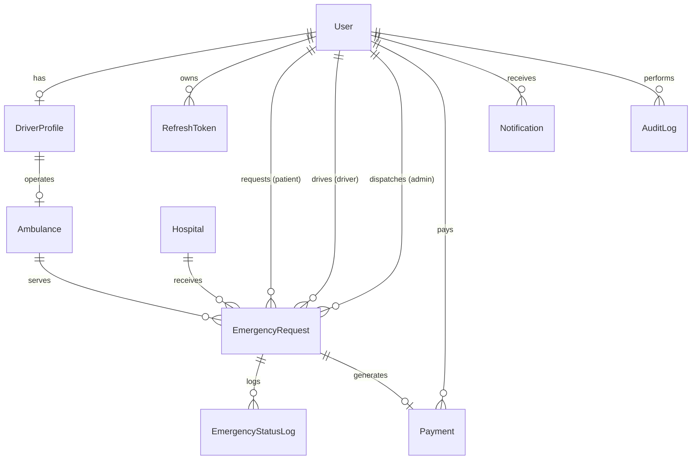

# 🚑 Emergency Ambulance Dispatch System — Backend API

A production-ready, transaction-safe RESTful API for **Emergency Ambulance Dispatch & Hospital Bed Coordination**, built with **Node.js, TypeScript, Express 5, PostgreSQL, Prisma 7, Zod, Redis, Stripe, and Google OAuth 2.0**.

> Built for **B7A6 Assignment #5 — Emergency Ambulance Dispatch**.

---

## 🔗 Quick Links

| Resource | Link |
|---|---|
| **Backend Repository** | https://github.com/IFTI-KAR/Assignment-6 |
| **Live API Base URL** | *(Pending Vercel deployment — updated after deploy)* |
| **Postman Collection** | [`docs/ambulance-dispatch.postman_collection.json`](./docs/ambulance-dispatch.postman_collection.json) |
| **Database Schema** | [`prisma/schema.prisma`](./prisma/schema.prisma) |

---

## ✨ Key Features

- **3 Distinct Roles & Strict RBAC**: `PATIENT` (emergency caller), `DRIVER` (ambulance operator), and `ADMIN` (dispatcher & system administrator).
- **Email/Password + Google (GCP) Social Login**:
  - `bcryptjs` password hashing, short-lived JWT access tokens, and **rotating SHA-256 hashed refresh tokens with reuse detection**.
  - Both Google ID-token verification (`POST /api/v1/auth/google`) and server-side OAuth 2.0 redirect flow (`GET /api/v1/auth/google` → `/callback`).
- **Automatic Medical Triage & Priority Queue**:
  - Emergency requests (`CARDIAC`, `STROKE`, `RESPIRATORY`, `TRAUMA`, `ACCIDENT`, `BURN`, `POISONING`, `MATERNITY`, `OTHER`) are scored `0–100` using vital signs (`isConscious`, `isBreathing`, `hasHeavyBleeding`, `patientAge`) and assigned `CRITICAL`, `HIGH`, `MEDIUM`, or `LOW` priority.
  - Dispatchers pull from `/api/v1/emergencies/queue` ordered by `priorityScore DESC, createdAt ASC` (FIFO within priority).
- **Concurrency-Safe Atomic Dispatch & Bed Reservation**:
  - `prisma.$transaction` with conditional `updateMany` claims both the `AVAILABLE` ambulance and the `PENDING` emergency atomically so no ambulance can ever be double-booked under concurrent requests.
  - Selecting a destination hospital atomically decrements `availableBeds` (and releases any previously reserved bed) and estimates distance & fare (`Haversine × 1.3 road factor`).
- **Strict Trip State Machine**:
  - `PENDING → DISPATCHED → EN_ROUTE → AT_PICKUP → PATIENT_ONBOARD → AT_HOSPITAL → COMPLETED` (or `CANCELLED` with automatic ambulance & bed rollback).
  - Completing a trip calculates `distanceKm` and `finalFare`, releases the ambulance at the hospital coordinates, increments `driverProfile.totalTrips`, and generates a `PENDING` bill.
- **Real Stripe Payment Integration**:
  - Hosted Stripe Checkout Sessions (`POST /api/v1/payments/checkout`), server-side verified `/success` & `/cancel` callbacks, raw-body `Stripe-Signature` webhook handler (`POST /api/v1/payments/webhook`) with idempotency, and admin Stripe refunds (`POST /api/v1/payments/:id/refund`).
- **Modern Backend Practices**:
  - Standardized JSON envelopes (`{ success, message, meta?, data }` / `{ success: false, message, errors }`)
  - Redis read-through caching for hospital directory & admin analytics (gracefully bypassed if `REDIS_URL` is omitted)
  - Soft deletes (`deletedAt`), immutable `AuditLog` trail, `EmergencyStatusLog` timeline, in-app `Notification` inbox, `helmet`, `cors`, and `express-rate-limit`
  - Cloudinary in-memory avatar upload (`multer` memoryStorage, serverless-safe)

---

## 🛠️ Tech Stack & Architecture

| Layer | Technology |
|---|---|
| **Runtime & Framework** | Node.js (>=20), TypeScript, Express 5 |
| **Database & ORM** | PostgreSQL + Prisma 7 (`@prisma/adapter-pg`) |
| **Validation** | Zod 4 |
| **Authentication** | `jsonwebtoken`, `bcryptjs`, `google-auth-library` |
| **Payments** | Stripe Checkout + Webhooks |
| **Caching & Rate Limiting** | `ioredis` (optional Redis cache) + `express-rate-limit` |
| **File Upload** | `multer` (memory) + `cloudinary` |
| **Security & Tooling** | `helmet`, `cors`, `morgan`, Biome, `tsup` |
| **Deployment** | Vercel Serverless Functions (`api/index.mjs` + `dist/server.js`) |

```text
Request
  │
  ▼
Express Middleware (helmet → cors → raw-webhook / json → rateLimiter)
  │
  ▼
Module Router (/api/v1/<module>)
  ├── auth(...roles)          # Bearer JWT verification + live DB status/role check
  ├── validateRequest(zod)    # Validates body, query, params
  ├── Controller              # Extracts validated input & formats response
  └── Service                 # Business rules, Prisma $transaction, Redis cache, AuditLog, Notify
  │
  ▼
notFound (404) → globalErrorHandler (Zod, JWT, Prisma, Multer, AppError → structured JSON)
```

---

## 👥 Role & Permission Matrix

| Capability | `PATIENT` | `DRIVER` | `ADMIN` |
|---|:---:|:---:|:---:|
| Register / Login / Google OAuth / Refresh / Profile | ✅ | ✅ | ✅ |
| Browse Hospitals & Find Nearby Hospitals | ✅ | ✅ | ✅ |
| Raise Emergency Request & Cancel Own (`PENDING`/`DISPATCHED`/`EN_ROUTE`) | ✅ | ❌ | ❌ (cancel ✅) |
| View Own Emergencies, Timeline & Public Tracking | ✅ | Assigned only | All ✅ |
| Toggle On/Off Duty, Push GPS, View Trip Summary | ❌ | ✅ | ❌ |
| Advance Trip State (`EN_ROUTE → ... → COMPLETED`) | ❌ | ✅ | ❌ |
| Select Destination Hospital & Reserve Bed | ❌ | ✅ | ✅ |
| Manage Hospitals, Ambulances, Verify Drivers, Dispatch | ❌ | ❌ | ✅ |
| Checkout & Pay Trip Bill (Stripe) / View Own Payments | ✅ | ❌ | View all & Refund ✅ |
| User Management, Dashboard Stats, Reports, Audit Logs | ❌ | ❌ | ✅ |

---

## 🗄️ Database Design (ERD)



---

## 🚦 Emergency Triage & State Machine

### Triage Scoring (`0–100`)

- **Base Score by Type**: `CARDIAC` (75), `STROKE` (75), `RESPIRATORY` (65), `TRAUMA` (60), `ACCIDENT` (55), `BURN` (55), `POISONING` (50), `MATERNITY` (45), `OTHER` (25)
- **Modifiers**: Not breathing (`+30`), Unconscious (`+20`), Heavy bleeding (`+15`), Age `<= 5` or `>= 65` (`+5`)
- **Priority Mapping**: `>= 85` `CRITICAL` · `>= 65` `HIGH` · `>= 40` `MEDIUM` · `< 40` `LOW`

### Trip Lifecycle

```text
PENDING ──(Admin dispatch)──▶ DISPATCHED ──▶ EN_ROUTE ──▶ AT_PICKUP ──▶ PATIENT_ONBOARD ──▶ AT_HOSPITAL ──▶ COMPLETED (Bill generated)
   │                              │              │             │
   └──────────────────────────────┴──────────────┴─────────────┴──(Cancel + rollback ambulance & bed)──▶ CANCELLED
```

---

## 🔐 Demo Credentials (Seeded)

Running `npm run db:seed` creates ready-to-test accounts:

| Role | Email | Password | Notes |
|---|---|---|---|
| **ADMIN** | `admin@rescue.com` | `Admin@12345` | Full dispatcher & admin access |
| **PATIENT** | `patient@rescue.com` | `Patient@12345` | Ayesha Rahman (caller) |
| **PATIENT** | `patient2@rescue.com` | `Patient@12345` | Tanvir Ahmed (caller) |
| **DRIVER** | `driver1@rescue.com` | `Driver@12345` | Verified, on-duty, `ADVANCED` ambulance |
| **DRIVER** | `driver2@rescue.com` | `Driver@12345` | Verified, on-duty, `BASIC` ambulance |
| **DRIVER (Unverified)** | `newdriver@rescue.com` | `Driver@12345` | Pending admin verification demo |

---

## 🚀 Getting Started (Local Development)

### 1. Prerequisites
- Node.js `>= 20`
- PostgreSQL database (local, Neon, or Supabase)
- Optional: Redis (Upstash/local), Stripe test account, Google Cloud OAuth credentials, Cloudinary account

### 2. Install & Configure

```bash
git clone https://github.com/IFTI-KAR/Assignment-6.git
cd Assignment-6
npm install
cp .env.example .env
```

Update `.env` with your credentials:

| Variable | Required | Description |
|---|:---:|---|
| `DATABASE_URL` | ✅ | PostgreSQL connection string |
| `JWT_ACCESS_SECRET` | ✅ | Secret (>=16 chars) for access tokens |
| `JWT_REFRESH_SECRET` | ✅ | Secret (>=16 chars) for refresh tokens |
| `APP_URL` | ✅ | Base API URL (e.g. `http://localhost:5000`) |
| `STRIPE_SECRET_KEY` | Payment | Stripe test secret (`sk_test_...`) |
| `STRIPE_WEBHOOK_SECRET` | Payment | Stripe webhook secret (`whsec_...`) |
| `GOOGLE_CLIENT_ID` | OAuth | Google Cloud OAuth 2.0 Client ID |
| `GOOGLE_CLIENT_SECRET` | OAuth | Google Cloud OAuth 2.0 Client Secret |
| `REDIS_URL` | Optional | Redis URL for caching (skipped if empty) |
| `CLOUDINARY_*` | Optional | Required only for `PATCH /users/me/avatar` |

### 3. Migrate & Seed Database

```bash
npm run db:generate
npx prisma migrate deploy
npm run db:seed
```

### 4. Run & Verify

```bash
npm run dev          # Watch mode on http://localhost:5000
npm run typecheck    # TypeScript check
npm run lint         # Biome lint + format check
npm run build        # Prisma generate + tsup bundle -> dist/server.js
npm start            # Run production bundle
```

---

## 📚 API Reference (68 Endpoints)

All module endpoints are prefixed with `/api/v1`.

### System & Health (2)
| Method | Endpoint | Access | Description |
|---|---|---|---|
| `GET` | `/` | Public | API status & metadata |
| `GET` | `/api/v1/health` | Public | DB & Redis health check |

### Authentication (9)
| Method | Endpoint | Access | Description |
|---|---|---|---|
| `POST` | `/api/v1/auth/register` | Public | Register patient account |
| `POST` | `/api/v1/auth/register/driver` | Public | Register driver with license info |
| `POST` | `/api/v1/auth/login` | Public | Email/password login |
| `POST` | `/api/v1/auth/refresh-token` | Public | Rotate refresh token |
| `POST` | `/api/v1/auth/logout` | Public | Revoke refresh token |
| `POST` | `/api/v1/auth/google` | Public | Google ID-token login |
| `GET` | `/api/v1/auth/google` | Public | Google OAuth redirect |
| `GET` | `/api/v1/auth/google/callback` | Public | Google OAuth callback |
| `PATCH` | `/api/v1/auth/change-password` | Auth | Change password & revoke sessions |

### User Profile (4)
| Method | Endpoint | Access | Description |
|---|---|---|---|
| `GET` | `/api/v1/users/me` | Auth | Get own profile & unread count |
| `PATCH` | `/api/v1/users/me` | Auth | Update name / phone |
| `PATCH` | `/api/v1/users/me/avatar` | Auth | Upload avatar to Cloudinary |
| `DELETE` | `/api/v1/users/me` | Auth | Soft delete own account |

### Hospitals (7)
| Method | Endpoint | Access | Description |
|---|---|---|---|
| `GET` | `/api/v1/hospitals` | Public | Paginated, filtered, cached hospital list |
| `GET` | `/api/v1/hospitals/nearby` | Auth | Nearby hospitals with free beds & ETA |
| `GET` | `/api/v1/hospitals/:id` | Public | Hospital details & incoming count |
| `POST` | `/api/v1/hospitals` | `ADMIN` | Create hospital |
| `PATCH` | `/api/v1/hospitals/:id` | `ADMIN` | Update hospital details |
| `PATCH` | `/api/v1/hospitals/:id/beds` | `ADMIN` | Update available/total beds |
| `DELETE` | `/api/v1/hospitals/:id` | `ADMIN` | Soft delete hospital |

### Ambulances (8)
| Method | Endpoint | Access | Description |
|---|---|---|---|
| `POST` | `/api/v1/ambulances` | `ADMIN` | Register ambulance |
| `GET` | `/api/v1/ambulances` | `ADMIN` | List fleet with filters & pagination |
| `GET` | `/api/v1/ambulances/available` | `ADMIN` | Nearest available ambulances with ETA |
| `GET` | `/api/v1/ambulances/:id` | `ADMIN`, `DRIVER` | Get ambulance details |
| `PATCH` | `/api/v1/ambulances/:id` | `ADMIN` | Update ambulance specs/fares |
| `PATCH` | `/api/v1/ambulances/:id/driver` | `ADMIN` | Assign or unassign driver |
| `PATCH` | `/api/v1/ambulances/:id/status` | `ADMIN` | Set AVAILABLE / MAINTENANCE / OFFLINE |
| `DELETE` | `/api/v1/ambulances/:id` | `ADMIN` | Soft delete ambulance |

### Drivers (6)
| Method | Endpoint | Access | Description |
|---|---|---|---|
| `GET` | `/api/v1/drivers/me/summary` | `DRIVER` | Personal trip & fare summary |
| `PATCH` | `/api/v1/drivers/me/duty` | `DRIVER` | Toggle on/off duty (+ GPS sync) |
| `PATCH` | `/api/v1/drivers/me/location` | `DRIVER` | Update live GPS coordinates |
| `GET` | `/api/v1/drivers` | `ADMIN` | List drivers with filters |
| `GET` | `/api/v1/drivers/:id` | `ADMIN` | Driver profile & recent trips |
| `PATCH` | `/api/v1/drivers/:id/verify` | `ADMIN` | Verify or revoke driver license |

### Emergencies & Dispatch (14)
| Method | Endpoint | Access | Description |
|---|---|---|---|
| `GET` | `/api/v1/emergencies/track/:trackingCode` | Public | Live public tracking for family |
| `GET` | `/api/v1/emergencies/queue` | `ADMIN` | Priority-ordered pending queue |
| `GET` | `/api/v1/emergencies/my-active` | `PATIENT`, `DRIVER` | Caller's/driver's active emergency |
| `POST` | `/api/v1/emergencies/dispatch-next` | `ADMIN` | Auto-dispatch highest-priority request |
| `POST` | `/api/v1/emergencies` | `PATIENT` | Raise emergency request + auto-triage |
| `GET` | `/api/v1/emergencies` | Auth | Role-scoped list with filters & search |
| `GET` | `/api/v1/emergencies/:id` | Auth | Role-scoped emergency details |
| `GET` | `/api/v1/emergencies/:id/timeline` | Auth | Chronological status log |
| `DELETE` | `/api/v1/emergencies/:id` | `ADMIN` | Soft delete closed emergency |
| `POST` | `/api/v1/emergencies/:id/dispatch` | `ADMIN` | Auto or manual ambulance dispatch |
| `PATCH` | `/api/v1/emergencies/:id/status` | `DRIVER` | Advance trip state machine |
| `PATCH` | `/api/v1/emergencies/:id/hospital` | `DRIVER`, `ADMIN` | Select hospital & reserve bed atomically |
| `PATCH` | `/api/v1/emergencies/:id/priority` | `ADMIN` | Override triage priority |
| `POST` | `/api/v1/emergencies/:id/cancel` | `PATIENT`, `ADMIN` | Cancel & rollback ambulance/bed |

### Payments — Stripe (7)
| Method | Endpoint | Access | Description |
|---|---|---|---|
| `POST` | `/api/v1/payments/checkout` | `PATIENT` | Create Stripe Checkout Session |
| `POST` | `/api/v1/payments/webhook` | Stripe | Raw-body verified Stripe webhook |
| `GET` | `/api/v1/payments/success` | Public | Server-side session verification |
| `GET` | `/api/v1/payments/cancel` | Public | Expire session & mark cancelled |
| `GET` | `/api/v1/payments` | `PATIENT`, `ADMIN` | List payments + `totalPaid` |
| `GET` | `/api/v1/payments/:id` | `PATIENT`, `ADMIN` | Payment details |
| `POST` | `/api/v1/payments/:id/refund` | `ADMIN` | Issue Stripe refund |

### Notifications (3)
| Method | Endpoint | Access | Description |
|---|---|---|---|
| `GET` | `/api/v1/notifications` | Auth | List notifications + unread count |
| `PATCH` | `/api/v1/notifications/read-all` | Auth | Mark all read |
| `PATCH` | `/api/v1/notifications/:id/read` | Auth | Mark one read |

### Admin Operations (8)
| Method | Endpoint | Access | Description |
|---|---|---|---|
| `GET` | `/api/v1/admin/users` | `ADMIN` | List users with filters & search |
| `GET` | `/api/v1/admin/users/:id` | `ADMIN` | User details & counts |
| `PATCH` | `/api/v1/admin/users/:id/role` | `ADMIN` | Change user role |
| `PATCH` | `/api/v1/admin/users/:id/status` | `ADMIN` | Activate or block user |
| `DELETE` | `/api/v1/admin/users/:id` | `ADMIN` | Soft delete user |
| `GET` | `/api/v1/admin/dashboard-stats` | `ADMIN` | Cached operational metrics |
| `GET` | `/api/v1/admin/reports/emergencies` | `ADMIN` | Date-range incident & revenue report |
| `GET` | `/api/v1/admin/audit-logs` | `ADMIN` | Searchable audit log viewer |

---

## 📮 Postman Collection & Stripe / GCP Setup

1. Import [`docs/ambulance-dispatch.postman_collection.json`](./docs/ambulance-dispatch.postman_collection.json) into Postman.
2. Update the collection variable `baseUrl` (`http://localhost:5000` or your deployed Vercel URL).
3. Run `02. Authentication -> Login (Seeded Demo Credentials)` for Admin, Patient, and Driver — test scripts auto-populate `adminToken`, `patientToken`, and `driverToken`.
4. **Stripe Local Webhook Testing**:
   ```bash
   stripe listen --forward-to localhost:5000/api/v1/payments/webhook
   ```
5. **Google OAuth (GCP)**:
   - Create an OAuth 2.0 Client ID in Google Cloud Console (`Web application`).
   - Add `<APP_URL>/api/v1/auth/google/callback` to **Authorized redirect URIs**.

---

## ☁️ Deploying to Vercel

1. Push the repository to GitHub or run `vercel --prod`.
2. Add environment variables in Vercel Project Settings (`DATABASE_URL`, `JWT_ACCESS_SECRET`, `JWT_REFRESH_SECRET`, `APP_URL`, `STRIPE_SECRET_KEY`, `STRIPE_WEBHOOK_SECRET`, `GOOGLE_CLIENT_ID`, `GOOGLE_CLIENT_SECRET`).
3. Run migrations & seed against your production Postgres database:
   ```bash
   npx prisma migrate deploy
   npm run db:seed
   ```
